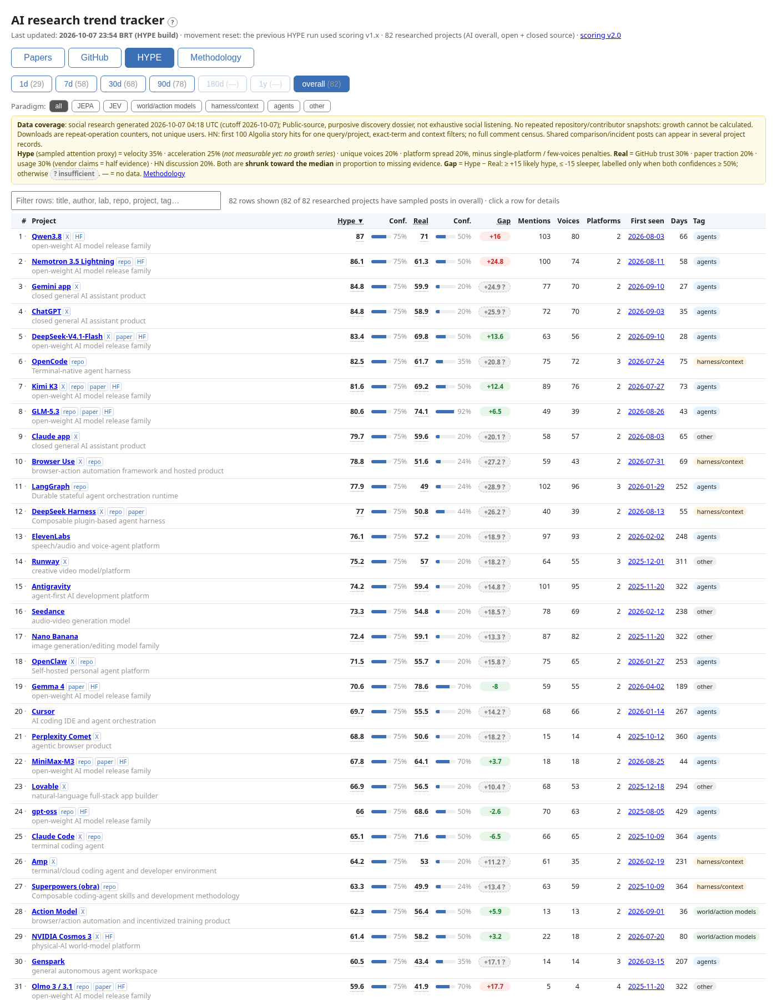

# trending-research

[](LICENSE)
[](https://creativecommons.org/licenses/by/4.0/)

An evolving, open AI intelligence observatory. Its current executable tracker ranks **papers** and **GitHub repos** on AI agents, harnesses and context layers, JEPA, JEV (decision models), and world and action models. A third view compares sampled **Attention** with **Discovery** proxies across AI projects. These scores help find leads for investigation; they do not establish capability, adoption, economic value or truth.



## Research and roadmap state

This repository is also an open research experiment in autonomous delivery: comparing models and harnesses while they work on real tasks. The fixed **100-hour diagnostic window is 2026-10-10 18:19 UTC–2026-10-14 22:19 UTC**, not a proven goal-activation interval or 100 hours of active compute/coding. See [research experiment and telemetry](docs/research-experiment.md) for dated measurements, reconciliation and comparison limits.

The **2026-10-15 measured research checkpoint** confirms 2,429 stored records from a parent-only historical prefix and a bounded live cohort, including automatically discovered documentation-worker activity. Instrumentation is private; this repository publishes sanitized methods and results, not deployable instrumentation or raw telemetry. The new bridge is **stopped/disabled under an explicit human maintenance hold**: production rollback/restore and resumed suffix delivery remain unverified. Automatic capture stopped around **19:35 UTC on October 15**; later activity is outside these verified cohorts and subsequent eligible-suffix growth is unknown. Stored history is not continuous current delivery, whole-harness spend or a model-efficiency ranking.

The [observatory roadmap](.genie/wishes/open-intelligence-observatory/WISH.md) is **in progress**, with [tracking issue #1](https://github.com/namastex888/trending-research/issues/1), 20 child issues (#2–#21), five milestones, 80 original criteria and 41 dependencies. Six issues (#2, #3, #5, #6, #8 and #11) have historical local acceptance for their original and quality gates; 14 remain unaccepted, and none of the five milestone exits is accepted. Local acceptance does not make the whole observatory complete or a public product release.

Work is aggregated in [PR #22](https://github.com/namastex888/trending-research/pull/22), targeting `main`. The rebased comparison baseline is `aa932ad3c29af7f5a67c3060344af97bc8d87c75`; the [continuation runbook](.genie/wishes/open-intelligence-observatory/checkpoints/2026-10-14/CONTINUE.md), [checkpoint](.genie/wishes/open-intelligence-observatory/checkpoints/2026-10-14/checkpoint.json) and [rebase record](.genie/wishes/open-intelligence-observatory/checkpoints/2026-10-14/REBASE.md) explain the handoff and remaining gates. The checkpoint JSON predates the rebase, so its `current_head` is historical. PR #22 had no CI checks in the latest verified snapshot; this README does not claim a CI pass.

## Quickstart

```bash
git clone https://github.com/namastex888/trending-research && cd trending-research
python -m http.server 8765 -d web   # open http://localhost:8765 to browse the committed snapshot
```

`web/` is a static page (`index.html` plus `data.json` and `hype.json`), so any static host can serve the snapshot offline. To check the current scoring code against bundled fixtures without refreshing data, run `python eval.py --features tests/fixtures/features_a.json tests/fixtures/features_b.json --hype tests/fixtures/hype_small.json`.

An optional network refresh is `python run.py`; it calls external source APIs and is separate from browsing or fixture evaluation. Install [requirements.txt](requirements.txt) first if needed (`tzdata` on Windows); `gh auth login` can raise GitHub API limits. There is no hosted copy yet.

## The page

| Tab | What it ranks | Score |
|---|---|---|
| **Papers** | arXiv / Hugging Face papers on the subjects above | HF upvote momentum 40%, linked-repo activity proxy 35%, HN mention momentum 25% |
| **GitHub** | repos on the same subjects | activity discovery index: star growth, issues, PRs, created-and-merged PR cohort when observed, commits and contributors |
| **HYPE** | sampled AI projects, open and closed source | **Attention** (sampled posts) vs **Discovery** (available GitHub, paper and discussion proxies); sourced usage families appear separately |
| **Methodology** | renders [METHODOLOGY.md](METHODOLOGY.md) | every formula, weight and threshold |

Windows (1d, 7d, 30d, 90d, 180d, 1y, overall) filter by release, creation or push date. Paradigm buttons re-rank within a subject. Score tooltips distinguish raw score, evidence coverage and prior. Coverage measures observed signal completeness, not confidence in truth; verification, freshness and source independence remain unqualified.

## Method in one minute (current scoring v3.0)

1. **Normalize** each signal against the whole run's distribution: `u = min(1, log1p(v) / log1p(P95))`. One outlier can't squash the rest, and a small window can't inflate its few items.
2. **Combine** present compatible signals with fixed weights. **Evidence coverage** is the weighted share observed, with discounts for rate proxies; usage families stay outside the HYPE discovery composite.
3. **Anti-noise**: star spikes without matching issue, PR or commit activity are capped. Solo repos, one-off spikes, single-post and single-platform attention are discounted.
4. **Shrink** GitHub and Papers scores toward their reference median: `score = prior + coverage * (raw - prior)`. HYPE Attention and Discovery instead shrink within their own percentile cohorts toward 50.
5. **Momentum** uses real deltas between our own snapshots, blended with the since-release rate while history is shorter than the window. With no snapshot it falls back to per-day-since-release rates, marked `~` (rate proxy).
6. **Gap** = Attention − Discovery: a difference between percentiles from different proxy cohorts. Labels describe which proxy is ahead only when both coverage values reach 50%; they are not capability or economic verdicts.
7. **Arrows** compare ranks only among items present in both runs, with hysteresis, so small changes don't flip them.

The committed `web/data.json` paper and GitHub numbers are a **historical v2 numeric archive**, with original scores and generation clocks preserved and coverage labels clarified. They have not been rescored as v3. The HYPE view uses v3 Attention and Discovery projections, while some linked activity inputs remain historical v2. All weights and thresholds are in [scoring_config.json](scoring_config.json), and the code is [scoring.py](scoring.py). Full details, including known biases: [METHODOLOGY.md](METHODOLOGY.md).

## Data coverage

- Sources: arXiv API, Hugging Face papers API, Hacker News (Algolia), GitHub REST API. HYPE also uses a social-research dossier: a purposive, public-only sample of X, Reddit, LinkedIn, HN, YouTube, Discord and Telegram posts. HN dominates it (about 2,019 of 2,163 sampled posts), and it is not committed.
- Reddit, X and LinkedIn have no free API in the pipeline. The GitHub stargazer-timestamp endpoint returned HTTP 404 in our runs, so star growth comes from our own snapshots, which are young until runs accumulate.
- HYPE counts are **samples**, not platform-wide totals. Acceleration can't be measured yet (no growth series). Downloads count operations, not unique users.
- **Numbers are never invented.** Missing data shows as — and reduces evidence coverage when applicable. Every source failure is listed under "Data sources" on the page.

## Repository layout

```
run.py               fetch -> features -> score -> web/data.json (+ history/, cache/: not committed)
hype_build.py        HYPE tab: research dossier -> web/hype.json
scoring.py           current v3 scoring plus frozen historical v2 mode
scoring_config.json  every weight and threshold
eval.py              stability / evidence / HYPE-shortlist report for scoring PRs
METHODOLOGY.md       the method (run.py copies it to web/ for the page)
web/                 static page + data snapshots (CC BY 4.0)
tests/               unit tests + a small real-data fixture
```

## Contributing

Weight changes, new data sources, seed queries and bug reports are welcome. Read [CONTRIBUTING.md](CONTRIBUTING.md). In short: edit the config, run `python eval.py`, paste its output into the PR, and never invent a number.

## Citation

If you use the tracker, its method or its data, please cite it ([CITATION.cff](CITATION.cff)):

```bibtex
@software{rosa_trending_research_2026,
  author  = {Rosa, Felipe and {Namastex}},
  title   = {trending-research: an open, evidence-weighted tracker of AI research papers, repositories and hype},
  year    = {2026},
  version = {2.0},
  url     = {https://github.com/namastex888/trending-research}
}
```

## License

Code: [MIT](LICENSE). Data snapshots in `web/*.json`: [CC BY 4.0](https://creativecommons.org/licenses/by/4.0/). Upstream sources keep their own terms.
